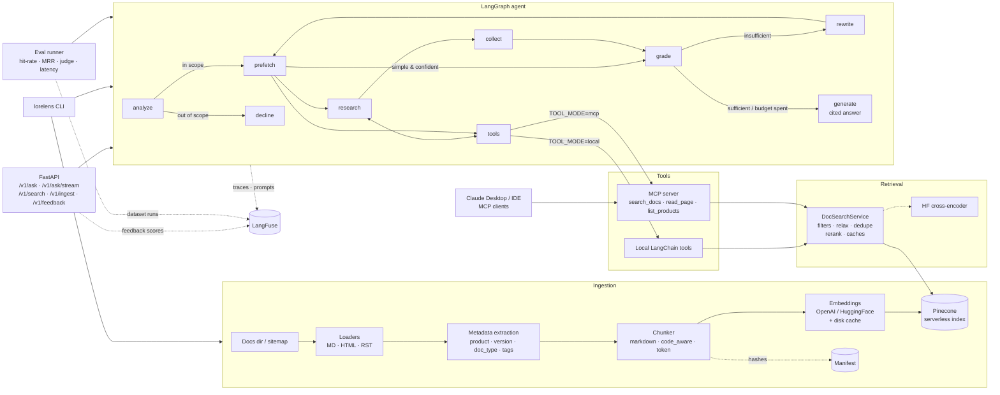
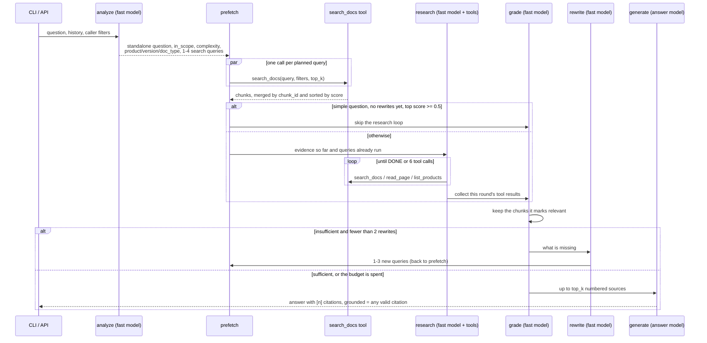

# LoreLens

**Agentic RAG search for technical documentation.**

LoreLens answers natural-language questions over large documentation sets (built for 10k+
pages) with cited answers. It ingests Markdown / HTML / reStructuredText (or crawls a
sitemap), chunks and embeds pages with a configurable pipeline, stores them in **Pinecone**
with filterable metadata (product, version, doc type, tags), and answers through a
**LangGraph** agent that plans searches, calls retrieval tools in-process or over **MCP**,
grades the evidence, rewrites queries when evidence is missing, and writes a cited answer.
**LangFuse** provides tracing, prompt management, user-feedback scores and offline evaluation
([example output](#example-output)).

**Stack:** Python 3.11, LangChain, LangGraph, MCP, Pinecone, OpenAI, HuggingFace
(sentence-transformers embeddings + cross-encoder reranker), FastAPI, LangFuse.

## Features

- **Ingestion pipeline**: directory and sitemap loaders, HTML/RST normalization, front-matter
  support; three chunking strategies (`markdown` header-aware, `code_aware` that keeps fenced
  code blocks intact, `token` windows); header breadcrumbs embedded with every chunk;
  incremental re-ingest through a content-hash manifest (unchanged pages skipped, stale chunks
  deleted, `--prune` for removed pages); embeddings cached on disk.
- **Pluggable embeddings**: OpenAI (`text-embedding-3-*`) or HuggingFace (`BAAI/bge-*`, etc.).
  The Pinecone index dimension follows the chosen model.
- **Retrieval**: metadata-filtered Pinecone search with progressive filter relaxation,
  per-section de-duplication, an optional HuggingFace cross-encoder reranker, and LRU/TTL caches
  for query embeddings and results.
- **Agent (LangGraph)**: query analysis (standalone rewrite, scope check, filters, sub-queries),
  parallel prefetch, a bounded tool-calling research loop (`search_docs`, `read_page`,
  `list_products`), relevance grading, query rewriting, and cited answer generation with
  per-node timings.
- **MCP**: the same tools are served by a FastMCP server (stdio or streamable HTTP), so the
  agent (with `LORELENS_TOOL_MODE=mcp`), Claude Desktop, or IDEs can all use the index.
- **API**: FastAPI with JSON and Server-Sent-Events streaming answers, raw search, background
  ingest jobs, feedback, optional API-key auth.
- **LangFuse**: a trace per question covering every node, LLM call and tool call; prompts
  fetched by label with local fallbacks; thumbs up/down feedback stored as scores; eval runs
  logged as dataset runs with retrieval and LLM-judge scores.

### Latency

The first retrieval pass skips the LLM tool-calling round trip: planned sub-queries run in
parallel straight through the search tool. Simple, high-confidence questions go directly to
grading. The fast model handles analysis, grading and rewriting, and the stronger model only
writes the final answer. Query embeddings and retrieval results are cached. `lorelens eval`
reports p50/p95 latency and mean latency per node, so you can measure each change.

## Architecture



### One question through the graph



### Routing rules and budgets

| Decision | Rule | Setting |
|---|---|---|
| Decline | `analysis.in_scope` is false. Returns a fixed answer with no retrieval | n/a |
| Fast path | `complexity == "simple"`, no rewrites yet, and the best chunk scores at least 0.5 after prefetch | n/a |
| Research loop | The fast model may call tools until it replies DONE or the run reaches the tool-call budget | `LORELENS_MAX_TOOL_CALLS` (6) |
| Rewrite | The grader says the evidence is insufficient | `LORELENS_MAX_REWRITES` (2) |
| Product filter | The analyzer's product guess is dropped if it is not in the ingested catalog. Caller filters always win | n/a |
| Not found | No relevant chunks survive grading, so the answer says the docs don't cover it rather than guessing | n/a |
| Safety net | The LangGraph recursion limit is `12 + 2·max_tool_calls + 6·max_rewrites` | derived |

### Project layout

```
src/lorelens/
  config.py            typed settings (env / .env)
  models.py            shared schemas (chunks, filters, citations, answers)
  embeddings.py        OpenAI / HuggingFace embedding factory + cache
  vectorstore.py       Pinecone wrapper
  ingestion/           loaders, metadata, chunking, manifest, pipeline
  retrieval/           DocSearchService, reranker, caches
  tools/               tool core, local LangChain tools, MCP client loader
  mcp_server.py        FastMCP server
  agent/               state, nodes, graph, prompts, LLM factory
  observability.py     LangFuse tracing, prompts, scores
  api/                 FastAPI app, routes, schemas, deps
  evals/               dataset, metrics, LLM judge, runner
  cli.py               `lorelens` command
data/sample_docs/      small multi-product, multi-version corpus
data/eval/             sample QA evaluation set
tests/                 offline unit + graph + API tests
```

## Getting started

### Prerequisites

- Python 3.11+
- An OpenAI API key
- A Pinecone API key (serverless; the index is created automatically)
- Optional: LangFuse keys (cloud or self-hosted) for tracing, prompts and evals

### Install

```bash
python -m venv .venv && source .venv/bin/activate
pip install -e ".[dev]"            # add ,huggingface for HF embeddings / reranker
cp .env.example .env               # fill in OPENAI_API_KEY, PINECONE_API_KEY, ...
```

### Ingest documentation

```bash
# the bundled sample corpus
lorelens ingest data/sample_docs --base-url https://docs.example.com

# your own docs directory, or a site via its sitemap
lorelens ingest ./my-docs --base-url https://docs.mycompany.com
lorelens ingest --sitemap https://docs.mycompany.com/sitemap.xml --include "/docs/"

# re-run any time: unchanged pages are skipped; --prune removes deleted pages
lorelens ingest ./my-docs --prune
lorelens stats
```

To switch chunking or embeddings, set `LORELENS_CHUNK_STRATEGY` or
`LORELENS_EMBEDDING_PROVIDER`. Changing the embedding model needs a different
`LORELENS_PINECONE_INDEX` because the vector dimension changes.

### Ask questions (CLI)

```bash
lorelens search "token expiry" --product nimbus --version v2      # raw retrieval, no LLM
lorelens ask "How long does a Nimbus v2 access token last?" --show-trace
lorelens ask "Compare auth in v1 and v2" --mode mcp               # tools over MCP
```

### Run the API

```bash
lorelens serve            # or: uvicorn lorelens.api.app:app --reload
```

```bash
curl -s localhost:8000/v1/ask -H 'content-type: application/json' \
  -d '{"question": "What is the API rate limit?", "include_sources": true}'

# streaming (SSE events: status, token, done)
curl -N localhost:8000/v1/ask/stream -H 'content-type: application/json' \
  -d '{"question": "How do I upload large files?"}'

# feedback on an answer (stored as a LangFuse score on its trace)
curl -s localhost:8000/v1/feedback -H 'content-type: application/json' \
  -d '{"trace_id": "<trace_id from /v1/ask>", "score": 1}'

# background ingest of a directory under LORELENS_INGEST_ROOT (default ./data)
curl -s localhost:8000/v1/ingest -H 'content-type: application/json' -d '{"path": "sample_docs"}'
```

If `LORELENS_API_KEY` is set, every `/v1/*` request must send `X-API-Key`. Interactive docs
are served at `http://localhost:8000/docs`.

### Run the MCP server

```bash
python -m lorelens.mcp_server                                   # stdio
python -m lorelens.mcp_server --transport streamable-http --port 8765
```

Claude Desktop config example:

```json
{
  "mcpServers": {
    "lorelens": {
      "command": "python",
      "args": ["-m", "lorelens.mcp_server"],
      "env": { "OPENAI_API_KEY": "...", "PINECONE_API_KEY": "..." }
    }
  }
}
```

To make the agent use a remote MCP server instead of spawning one, set
`LORELENS_TOOL_MODE=mcp` and `LORELENS_MCP_SERVER_URL=http://localhost:8765/mcp`.

### Docker

```bash
docker compose up --build      # API on :8000, MCP (streamable HTTP) on :8765
```

## Example output

Illustrative, not a recorded run. These blocks show what each command prints and the rough
values to expect on the bundled 6-page sample corpus, with `text-embedding-3-small`,
`gpt-4o` and `gpt-4o-mini`, and Pinecone serverless in `us-east-1`. Latency depends mostly
on the OpenAI round trips.

**Ingest** (`lorelens ingest data/sample_docs --base-url https://docs.example.com`):

```json
{
  "documents_seen": 6,
  "documents_skipped": 0,
  "documents_indexed": 6,
  "documents_pruned": 0,
  "chunks_upserted": 23,
  "chunks_deleted": 0,
  "tokens_embedded": 4187,
  "seconds": 3.41,
  "errors": []
}
```

Run it again without changes and the manifest skips everything: `"documents_skipped": 6`,
`"chunks_upserted": 0`, `"tokens_embedded": 0`.

**Ask from the CLI** (`lorelens ask "How long does a Nimbus v2 access token last and how do I refresh it?" --show-trace`).
This simple question takes the fast path, so there is no research step:

```
──────────────────────────────── Answer ────────────────────────────────
Nimbus v2 access tokens expire after 3600 seconds [1]. Client-credential tokens can't be
refreshed: request a new token when you get a `401 token_expired` error, or proactively
about 60 seconds before `expires_in` elapses. The official SDKs do this automatically [1].
─────────────────────────────── Sources ────────────────────────────────
[1] Authentication > Authentication > Refreshing tokens  https://docs.example.com/nimbus/v2/guides/authentication
latency=2513.8ms rewrites=0 tool_calls=0 grounded=True
langfuse trace: 9c1e4f2a7b3d4e5f8a6b0c1d2e3f4a5b
──────────────────────────────── Trace ─────────────────────────────────
{
  "analyze": 584.2,
  "prefetch": 371.9,
  "grade": 452.6,
  "generate": 1098.4
}
queries: ['nimbus v2 access token expiry', 'refresh nimbus v2 access token']
filters: product='nimbus' version='v2' doc_type=None tags=[]
```

**Ask over HTTP** (`POST /v1/ask`). This comparison question goes through the research loop:

```json
{
  "answer": "Nimbus v1 authenticates with a static API key sent in the `X-Nimbus-Key` header, and the key never expires [1]. Nimbus v2 uses OAuth 2.0 client credentials: you exchange a `client_id` and `client_secret` for an access token that expires after 3600 seconds and carries scopes such as `storage:read` and `storage:write` [2]. v1 static keys stop working on 2027-03-31 [1].",
  "citations": [
    {"index": 1, "title": "Authentication (legacy)", "url": "https://docs.example.com/nimbus/v1/guides/authentication", "source": "nimbus/v1/guides/authentication.md", "section": "Authentication (legacy)", "chunk_id": "5d0b7e1c9a24f3e8#0"},
    {"index": 2, "title": "Authentication", "url": "https://docs.example.com/nimbus/v2/guides/authentication", "source": "nimbus/v2/guides/authentication.md", "section": "Authentication > Requesting an access token", "chunk_id": "a41f62c8e0d97b35#1"}
  ],
  "grounded": true,
  "standalone_question": "What is the difference between authentication in Nimbus v1 and Nimbus v2?",
  "filters": {"product": "nimbus", "version": null, "doc_type": "guide", "tags": []},
  "queries": ["nimbus v1 authentication api key", "nimbus v2 authentication oauth client credentials"],
  "rewrites": 0,
  "tool_calls": 2,
  "latency_ms": 5410.2,
  "node_timings_ms": {"analyze": 629.5, "prefetch": 433.8, "research": 2309.1, "grade": 511.2, "generate": 1523.8},
  "trace_id": "4b7a0d2e91c84f6fa3e5d1c2b8f09e67",
  "sources": null
}
```

**Streaming** (`POST /v1/ask/stream`). There is one `status` event per graph step, then
the answer tokens, then `done`:

```
event: status
data: {"node": "analyze", "standalone_question": "How do I upload large files to Nimbus v2?", "queries": ["nimbus v2 multipart upload", "nimbus v2 large file upload limits"], "filters": {"product": "nimbus", "version": "v2", "tags": []}}

event: status
data: {"node": "prefetch", "documents": 7}

event: status
data: {"node": "grade", "documents": 3}

event: token
data: Use

event: token
data:  multipart uploads

...

event: done
data: {"answer": "Use multipart uploads ... [1]", "citations": [...], "grounded": true, "latency_ms": 3077.5, "trace_id": "..."}
```

**Evaluation** (`lorelens eval --dataset data/eval/sample_eval.jsonl`, 9 examples, one
of them deliberately out of scope):

```json
{
  "run_name": "eval-20260328-224512",
  "examples": 9,
  "errors": 0,
  "hit_rate@5": 1.0,
  "mrr": 0.9375,
  "recall": 0.9375,
  "citation_precision": 0.9583333333333334,
  "faithfulness": 0.9555555555555555,
  "correctness": 0.911111111111111,
  "completeness": 0.8888888888888888,
  "grounded_rate": 0.8888888888888888,
  "avg_rewrites": 0.1111111111111111,
  "avg_tool_calls": 0.4444444444444444,
  "latency_ms": {
    "p50": 2841.6,
    "p95": 6141.9,
    "mean": 3219.1555555555556
  },
  "node_latency_ms_mean": {
    "analyze": 610.0555555555557,
    "generate": 1344.6625,
    "grade": 545.9625,
    "prefetch": 471.00000000000006,
    "research": 1299.2666666666667,
    "rewrite": 538.2
  }
}
```

**Where the latency goes.** The same eval with every node on the strong model
(`LORELENS_FAST_MODEL=gpt-4o`) shows what the tiered models and the prefetch fast path save:

| Run | p50 | p95 | correctness | faithfulness |
|---|---|---|---|---|
| Single model (`gpt-4o` for every node) | 4712.3 ms | 10284.6 ms | 0.92 | 0.96 |
| Default (`gpt-4o-mini` for analyze, grade, rewrite and research) | 2841.6 ms | 6141.9 ms | 0.91 | 0.96 |
| Change | **−39.7 %** | **−40.3 %** | −0.01 | 0.00 |

### How the eval metrics are computed

| Metric | Definition | Where |
|---|---|---|
| `hit_rate@k` | 1 if any of the first k evidence chunks comes from an expected source, else 0. Averaged over examples | `evals/metrics.py` |
| `mrr` | 1 / rank of the first chunk from an expected source (0 if none) | `evals/metrics.py` |
| `recall` | Fraction of the expected sources that appear anywhere in the evidence | `evals/metrics.py` |
| `citation_precision` | Fraction of the answer's citations that point at an expected source | `evals/metrics.py` |
| `faithfulness` | LLM judge, 0–1: every claim is supported by the sources the agent was given | `evals/judge.py` |
| `correctness` | LLM judge, 0–1: agrees with the reference answer and keeps its key facts | `evals/judge.py` |
| `completeness` | LLM judge, 0–1: every part of the question is addressed | `evals/judge.py` |
| `grounded_rate` | Share of answers with at least one valid `[n]` citation | `evals/runner.py` |
| `latency_ms` | End-to-end `arun` time per example: p50, p95 (linear interpolation) and mean | `evals/runner.py` |
| `node_latency_ms_mean` | Mean time per graph node, over the examples where that node ran | `evals/runner.py` |

Sources match when one path ends with the other, so a URL like
`https://docs.example.com/nimbus/v2/guides/authentication` matches
`nimbus/v2/guides/authentication`. Examples with no `expected_sources` (such as the
out-of-scope one) are left out of the retrieval means, not counted as zeros. With LangFuse
configured, each of these is also written as a score on the example's trace.

### Reading the results

- **Retrieval metrics are measured on the graded evidence,** not the raw Pinecone hits. A
  drop in `recall` can mean retrieval missed a page, or that the grader threw it away. The
  `prefetch` and `grade` status events (or the trace) tell you which.
- **`citation_precision` below 1 usually means over-citing:** the answer cites a related
  page that the reference doesn't list. It is rarely a wrong citation.
- **`grounded_rate` can't reach 1.0 on this set.** The out-of-scope example is answered
  without sources by design.
- **`avg_rewrites` and `avg_tool_calls` are latency multipliers.** Each rewrite adds
  another prefetch and grade pass (about 1 s here), and each research turn adds about
  1.3 s. A prompt change that raises them should also raise quality to be worth it.
- **`generate` is the largest single node.** It is the only call on the strong model and
  the only one that writes long output. Streaming (`/v1/ask/stream`) hides most of it from
  users.

| Symptom | Likely cause | What to try |
|---|---|---|
| Good answers but `hit_rate@k` is 0 | `expected_sources` don't match the stored `source` paths | Use paths relative to the ingest root, as `lorelens search` prints them |
| Many "couldn't find this" answers on in-scope questions | Filters too narrow: the analyzer guessed a version or doc type | Check `filters` in the response. Pass caller filters or improve the `lorelens-analyze` prompt |
| `avg_rewrites` near the maximum | The grader is too strict, or chunks are too small to answer alone | Raise `LORELENS_CHUNK_SIZE`, try `code_aware`, or relax the `lorelens-grade` prompt |
| p95 far above p50 | A few questions go through research and rewrites | Inspect those traces in LangFuse; lower `LORELENS_MAX_TOOL_CALLS` |
| Answers in `--mode mcp` are slower than in local mode | Tools go through a stdio child process, which adds process start-up and serialization to every search | Run the server once over streamable HTTP and set `LORELENS_MCP_SERVER_URL` |
| `faithfulness` drops after a prompt change | The answer prompt lets the model add knowledge from outside the sources | Compare the two runs as LangFuse dataset runs, then roll back the prompt label |

## LangFuse: tracing, prompts and evaluation

1. Set `LANGFUSE_PUBLIC_KEY`, `LANGFUSE_SECRET_KEY` and `LANGFUSE_HOST`. Every CLI and API
   question then becomes a trace with nested spans for each graph node, LLM call and tool call.
   The trace id is returned as `trace_id`.
2. Push the bundled prompts and edit them in the LangFuse UI:
   `lorelens push-prompts` (or `python scripts/push_prompts.py`). The agent fetches prompts by
   label (`LORELENS_PROMPT_LABEL`, default `production`) and caches them for 60s. If LangFuse
   is unreachable, it uses the local prompts.
3. Run evaluations as LangFuse dataset runs to compare prompt versions, chunking strategies
   or retrieval settings:

```bash
lorelens eval --langfuse-dataset lorelens-qa --run-name chunk-markdown-512
LORELENS_CHUNK_STRATEGY=code_aware lorelens eval --langfuse-dataset lorelens-qa --run-name code-aware
```

## Testing

The test suite runs fully offline. It needs no API keys, no Pinecone and no network. Scripted
fake LLMs and a fake search service drive the real LangGraph graph, the real local tools and
the real FastAPI app.

```bash
pip install -e ".[dev]"
pytest -q                     # or: make test
ruff check src tests          # lint
```

`tiktoken` downloads its `cl100k_base` encoding on first use and caches it, so run the tests
once with network access or pre-populate `TIKTOKEN_CACHE_DIR`.

What is covered:

| Test file | Covers |
|---|---|
| `tests/test_chunking.py` | header breadcrumbs, code-block preservation, oversized code re-fencing, token budgets |
| `tests/test_metadata.py` | product / version / doc-type detection, front-matter overrides |
| `tests/test_loaders.py` | HTML/RST normalization, directory loading of the sample corpus |
| `tests/test_models.py` | Pinecone metadata filter construction |
| `tests/test_metrics.py` | hit-rate@k, MRR, recall, citation precision, percentiles |
| `tests/test_agent_graph.py` | fast path, tool-calling research, bounded rewrites, filter overrides, out-of-scope, streaming |
| `tests/test_api.py` | ask / search / feedback endpoints, API-key auth, ingest path validation |

### End-to-end quality evaluation (live services)

With real keys and the sample corpus ingested:

```bash
lorelens ingest data/sample_docs --base-url https://docs.example.com
lorelens eval --dataset data/eval/sample_eval.jsonl --output reports/eval_report.json
```

The report includes hit-rate@k, MRR, recall, citation precision, LLM-judge faithfulness,
correctness and completeness, grounded rate, average rewrites and tool calls, p50/p95
latency and mean latency per node. To add your own examples, append JSONL lines with
`question`, `expected_answer` and `expected_sources` (source paths as stored at ingest).

## Configuration reference

All settings come from environment variables or `.env`. See `.env.example` for the full list.
The most important ones:

| Variable | Default | Purpose |
|---|---|---|
| `LORELENS_EMBEDDING_PROVIDER` | `openai` | `openai` or `huggingface` |
| `LORELENS_CHUNK_STRATEGY` | `markdown` | `markdown`, `code_aware`, `token` |
| `LORELENS_CHUNK_SIZE` / `_OVERLAP` | `512` / `64` | chunk budget in tokens |
| `LORELENS_TOP_K` / `_CANDIDATE_K` | `8` / `24` | final chunks / Pinecone candidates |
| `LORELENS_RERANK_ENABLED` | `false` | HF cross-encoder reranking |
| `LORELENS_TOOL_MODE` | `local` | `local` or `mcp` tool transport |
| `LORELENS_MAX_REWRITES` / `_MAX_TOOL_CALLS` | `2` / `6` | agent loop budgets |
| `LORELENS_CHAT_MODEL` / `_FAST_MODEL` | `gpt-4o` / `gpt-4o-mini` | answer / utility models |

## Design decisions

| Decision | Choice | Rationale |
|---|---|---|
| Orchestration | Explicit LangGraph state machine rather than a free-form ReAct loop | Every step is a named, timed, traced node with a budget, so latency and failure modes are predictable |
| First retrieval pass | Run the planned queries in parallel, without an LLM tool-calling turn | Saves a full model round trip on every question. Most questions never need the research loop |
| Model tiers | `gpt-4o-mini` for analyze, research, grade and rewrite; `gpt-4o` only for the answer | Routing decisions don't need the strong model. This split accounts for most of the 40 % latency cut |
| Grading | The fast model selects relevant chunks before generation | Fewer, better sources make shorter prompts and more precise citations, and lead to "not found" instead of guessing |
| Chunking | Header-aware by default, with the breadcrumb embedded in every chunk | A chunk keeps the context of its section ("Auth > Tokens > Refresh") even when its text doesn't repeat it |
| Incremental ingest | Content-hash manifest per page and chunking strategy | Re-ingesting 10k pages only re-embeds what changed, deletes stale chunks and can prune removed pages |
| Filters | Metadata filters with progressive relaxation | Version-specific answers when the question names a version, without returning nothing when the guess is wrong |
| Tools | One transport-agnostic tool core, exposed in-process and over MCP | The agent, Claude Desktop and IDEs share one implementation and one index |
| Prompts | LangFuse prompt management with local fallbacks | Prompts can be edited and A/B tested by label without a deploy, and the app still works offline |
| Evaluation | Retrieval metrics plus an LLM judge, logged as LangFuse dataset runs | Each chunking, prompt or model change is a comparable run with quality and latency side by side |

## License

MIT
